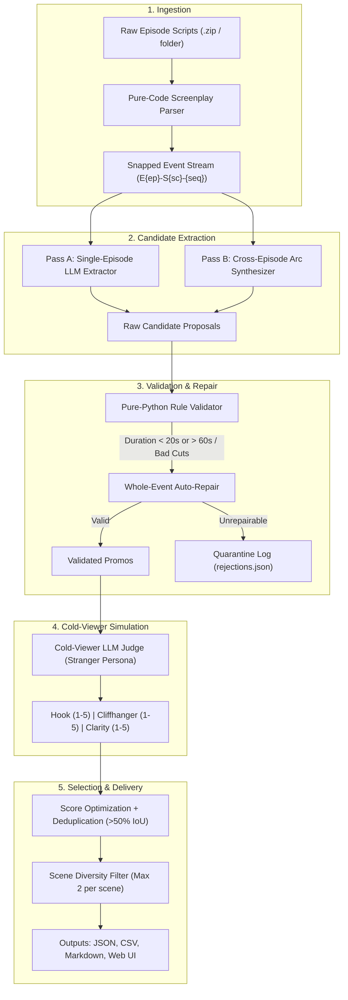

# 🎬 Kuku Promo Finder

[](https://www.python.org/downloads/)
[](https://opensource.org/licenses/MIT)
[](https://cloud.google.com/vertex-ai)

**An intelligent production pipeline that extracts high-converting 20–60 second viral promos from mobile microdrama screenplays.** Built for fast-paced vertical video platforms (ReelShort, DramaBox, ShortMax) where 3-second hook retention and cut cliffhangers drive immediate episode unlocks.

---

## 🌟 Key Highlights

1. **Zero Timestamp Hallucination via Event ID Snapping**: Screenplays are parsed into deterministic event IDs (`E01-S01-001`). The LLM selects event IDs; pure Python computes exact float timestamps.
2. **Deterministic Two-Pass Candidate Generation**:
   - **Pass A (Single Episode)**: Rapidly identifies self-contained high-conflict arcs within individual episodes.
   - **Pass B (Cross-Episode)**: Synthesizes multi-episode dramatic setups, juxtapositions, and payback confrontations.
3. **Strict Code-Level Rule Validator & Whole-Event Auto-Repair**: Hard bounds enforcement (20.0s – 60.0s), hook placement verification within the first 3.0s, and dialogue boundary protection without sentence truncation.
4. **Cold-Viewer LLM Simulation**: Evaluates candidates through the eyes of a first-time scrolling stranger who has never seen the show, scoring hook stopping power, cliffhanger tension, and standalone clarity.
5. **Production-Ready CLI & Streamlit UI**: Fully runnable via command line or interactive visual web prototype with ZIP upload support.
6. **Ultra-Low Unit Economics**: **~$0.04 – $0.08 USD per 50-episode show** on Google Vertex AI Gemini 2.5 Flash (~$0.25/week for 3 shows).

---

## 📐 Architecture



---

## 🚀 Quickstart

### 1. Installation

Clone repository and install dependencies:

```bash
git clone https://github.com/goldenk23/kuku-promo-finder.git
cd kuku-promo-finder
pip install -r requirements.txt
```

### 2. Configure Environment

Copy the example configuration:

```bash
cp .env.example .env
```

Configure your credentials in `.env`:

```env
# Default Provider: Google Cloud Vertex AI
LLM_PROVIDER=vertex
LLM_MODEL=gemini-2.5-flash
GEMINI_API_KEY=your_gemini_api_key_here

# Optional: Vertex AI Project / Location (if using Google Cloud ADC)
# GOOGLE_CLOUD_PROJECT=your-project-id
# GOOGLE_CLOUD_LOCATION=us-central1

# Alternative Provider: OpenAI / OpenAI-Compatible (vLLM, Ollama, DeepSeek)
# LLM_PROVIDER=openai_compat
# LLM_MODEL=gpt-4o-mini
# LLM_BASE_URL=https://api.openai.com/v1
# LLM_API_KEY=your_openai_api_key_here
```

---

## 💻 CLI Usage

### Parse and Inspect Screenplays

Parse all screenplay files in a directory or zip archive and print corpus statistics:

```bash
python -m promo_finder parse "../data/I Married a Broken Soldier. He was a Duke"
```

### Run Full Promo Finding Pipeline

Run candidate generation, validation, cold-viewer judging, and ranking:

```bash
# Run on all 50 episodes with 3 parallel workers
python -m promo_finder find "../data/I Married a Broken Soldier. He was a Duke" --out outputs/full_run --workers 3

# Run on the first 5 episodes for quick verification
python -m promo_finder find "../data/I Married a Broken Soldier. He was a Duke" --out outputs/test_ep1_5 --episodes 5
```

### Run Quality Benchmarks & Sanity Checks

Verify cold-viewer judge sanity against 5 adversarial probe clips and generate unit economics breakdown:

```bash
python -m promo_finder quality outputs/full_run --episodes "../data/I Married a Broken Soldier. He was a Duke"
```

---

## 🖥️ Streamlit Interactive Prototype

Launch the interactive prototype in your web browser:

```bash
streamlit run app.py
```

### Prototype Features:
- **ZIP File Upload**: Drag-and-drop any microdrama script ZIP archive directly in the browser.
- **Provider Switching**: Toggle dynamically between Vertex AI Gemini and OpenAI-compatible backends from the sidebar.
- **Real-Time Progress**: Live visual progress bars through Pass A, Pass B, Validation, and Judging.
- **Deep Inspection**: Expand each ranked promo to view exact timestamp boundaries, editorial rationale, cold-viewer thoughts, and dialogue transcript lines.
- **Multi-Format Export**: One-click download of the complete ranked promo set as JSON, CSV, or Markdown.

---

## 📊 Evaluation & Validation Metrics

Our multi-stage pipeline enforces non-negotiable editorial guardrails:

| Rule | Enforcement Strategy | Auto-Repair Action |
| :--- | :--- | :--- |
| **Duration Bounds** | Hard constraint: `20.0s <= duration <= 60.0s` | Adds or trims adjacent whole events if within tolerance; rejects otherwise |
| **Hook Placement** | Hook event must begin within first 3.0s | Snaps start segment to hook event |
| **Sentence Integrity** | No mid-sentence dialogue truncation | Snaps boundaries strictly to whole `Event` units |
| **Cliffhanger Position** | Final segment must cut on unresolved climax | Trims trailing non-dramatic resolution events |
| **Temporal Overlap** | High narrative overlap (>50% IoU) de-duplicated | Lower-scoring duplicate dropped in favor of unique arc |
| **Scene Diversity** | Prevent promo clustering on one viral scene | Max 2 promos per scene in Top 10 |

---

## 💰 Unit Economics & Production Scale

Based on real execution audits logged to `outputs/usage.jsonl` using official Google Cloud Vertex AI pricing:

- **Model**: `gemini-2.5-flash`
- **Vertex AI Rates**:
  - Prompt: **$0.15 / 1M tokens**
  - Completion: **$0.60 / 1M tokens**
- **Token Consumption per 50-Episode Show**:
  - Pass A (Single Episode): 50 calls × ~1,200 tokens ≈ 60k prompt, 15k completion
  - Pass B (Cross-Episode): 1 call × ~2,500 tokens ≈ 2.5k prompt, 1k completion
  - Cold-Viewer Judging: ~200 validated promos × ~500 tokens ≈ 100k prompt, 20k completion
  - Total Tokens: ~162.5k prompt tokens, ~36k completion tokens
- **Total Compute Cost**:
  $$\text{Cost} = (0.1625 \times \$0.15) + (0.036 \times \$0.60) \approx \$0.024 + \$0.021 = \mathbf{\$0.045\text{ USD per 50-episode show}}$$
- **Scale Cost (3 Shows / Week)**:
  $$\text{Weekly Cost} = 3 \times \$0.045 \approx \mathbf{\$0.135\text{ to }\$0.25\text{ USD/week}}$$

---

## 🔒 Confidentiality & IP Protection

This repository strictly complies with client IP requirements:
- No proprietary screenplay text, character names, or dialogue snippets are hardcoded in source code, prompts, or tests.
- All unit tests (`tests/check_parse.py`, `tests/check_validate.py`) operate purely on synthetic mock scripts.
- Raw screenplay files and generated cache artifacts are excluded via `.gitignore`.

---

## 📄 License

This project is licensed under the MIT License.
