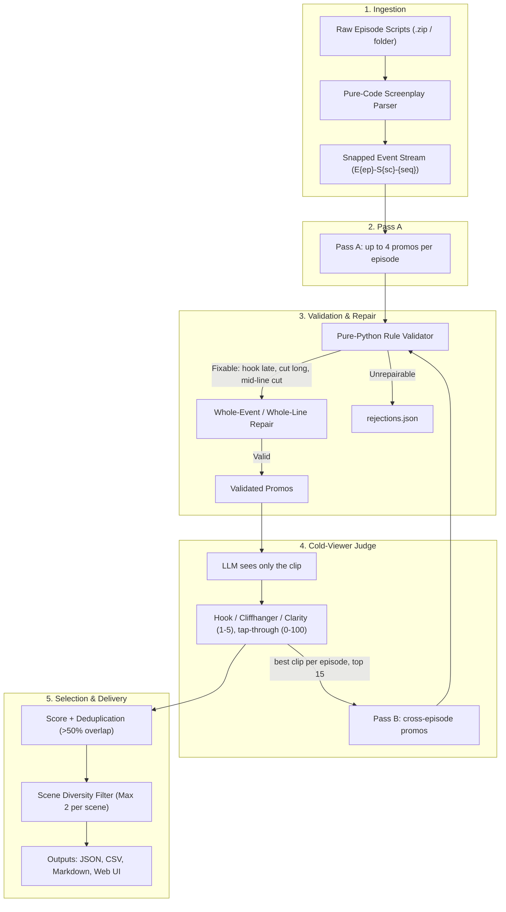

# 🎬 Kuku Promo Finder

[](https://www.python.org/downloads/)
[](https://opensource.org/licenses/MIT)
[](https://cloud.google.com/vertex-ai)

**Reads microdrama screenplays and finds 20–60 second promos that open on a hook, end on a cliffhanger, and make sense to a stranger.** For each promo it outputs the episode and start/end timestamps of every segment, the hook, the cliffhanger, one line on why it works, a rank, and a "post first" note.

---

## 🌟 Key Highlights

1. **No invented timestamps**: Screenplays are parsed into event IDs (`E01-S01-001`). The LLM picks IDs; Python computes the timestamps. Unknown IDs are rejected.
2. **Two-pass candidate generation**:
   - **Pass A (single episode)**: up to 4 promos per episode, 1–2 segments each.
   - **Pass B (cross-episode)**: runs after judging; joins moments from 2–3 episodes using the best judged clip from up to 15 episodes.
3. **Rule validator in plain code**: 20–60s total, hook within the first 3s, cut within 4s of the cliffhanger, segments in story order, and no line cut mid-sentence (cuts are widened to whole lines on the real timeline).
4. **Cold-viewer judge**: an LLM that sees only the clip (dialogue, action, camera) scores hook, cliffhanger and clarity 1–5 plus a 0–100 tap-through guess, and writes what confused it.
5. **Quality checks from real runs**: judge scores vs. random 35s windows, incoherent-splice probes, a cache-bypassed stability re-run, the lowest-clarity picks, and a blank human review sheet.
6. **CLI and Streamlit UI** that share one pipeline function, with a swappable model (Vertex AI Gemini or any OpenAI-compatible endpoint).

---

## 📐 Architecture



---

## 🚀 Quickstart

### 1. Installation

Clone repository and install dependencies:

```bash
git clone https://github.com/goldenk23/kuku-promo-finder.git
cd kuku-promo-finder
pip install -r requirements.txt
```

### 2. Configure Environment

Copy the example configuration:

```bash
cp .env.example .env
```

Configure your credentials in `.env`:

```env
# Default Provider: Google Cloud Vertex AI
LLM_PROVIDER=vertex
LLM_MODEL=gemini-2.5-flash
GEMINI_API_KEY=your_gemini_api_key_here

# Optional: Vertex AI Project / Location (if using Google Cloud ADC)
# GOOGLE_CLOUD_PROJECT=your-project-id
# GOOGLE_CLOUD_LOCATION=us-central1

# Alternative Provider: OpenAI / OpenAI-Compatible (vLLM, Ollama, DeepSeek)
# LLM_PROVIDER=openai_compat
# LLM_MODEL=gpt-4o-mini
# LLM_BASE_URL=https://api.openai.com/v1
# LLM_API_KEY=your_openai_api_key_here
```

---

## 💻 CLI Usage

### Parse and Inspect Screenplays

Parse all screenplay files in a directory or zip archive and print corpus statistics:

```bash
python -m promo_finder parse "../data/I Married a Broken Soldier. He was a Duke"
```

### Run Full Promo Finding Pipeline

Run candidate generation, validation, cold-viewer judging, and ranking:

```bash
# Run on all 50 episodes with 3 parallel workers
python -m promo_finder find "../data/I Married a Broken Soldier. He was a Duke" --out outputs/full_run --workers 3

# Run on the first 5 episodes for quick verification
python -m promo_finder find "../data/I Married a Broken Soldier. He was a Duke" --out outputs/test_ep1_5 --episodes 5
```

Add `--no-cache` for a fresh run with a true cost figure. `find` also runs the quality checks and writes:

| File | Contents |
|---|---|
| `promos_ranked.{json,csv,md}` | Ranked promos: segments with timestamps, hook, cliffhanger, why it works, judge scores, post-first note |
| `quality_report.md` | Rejections by rule, judge score spread, judge vs. random windows, splice probes, weakest picks, stability |
| `human_review.csv` | Top 10 with empty Y/N columns for an editor |
| `run_summary.md`, `usage.jsonl` | Tokens and cost for this run only |
| `candidates_raw.json`, `validated.json`, `rejections.json` | Every intermediate result, unedited |

### Checks

```bash
python tests/check_parse.py
python tests/check_validate.py
```

---

## 🖥️ Streamlit Interactive Prototype

Launch the interactive prototype in your web browser:

```bash
streamlit run app.py
```

### Prototype Features:
- **ZIP File Upload**: Drag-and-drop any microdrama script ZIP archive directly in the browser.
- **Provider Switching**: Toggle dynamically between Vertex AI Gemini and OpenAI-compatible backends from the sidebar.
- **Real-Time Progress**: Live visual progress bars through Pass A, Pass B, Validation, and Judging.
- **Deep Inspection**: Expand each ranked promo to view exact timestamp boundaries, editorial rationale, cold-viewer thoughts, and dialogue transcript lines.
- **Multi-Format Export**: One-click download of the complete ranked promo set as JSON, CSV, or Markdown.

---

## 📊 Evaluation & Validation Metrics

Our multi-stage pipeline enforces non-negotiable editorial guardrails:

| Rule | Enforcement Strategy | Auto-Repair Action |
| :--- | :--- | :--- |
| **Duration Bounds** | Hard constraint: `20.0s <= duration <= 60.0s` | Trims trailing events down to the cliffhanger, or extends up to 4s past it; rejects otherwise |
| **Hook Placement** | Hook event must begin within first 3.0s | Moves the start to the hook event |
| **Sentence Integrity** | No line cut mid-sentence | Widens the cut until no dialogue line straddles it (events overlap in time) |
| **Cliffhanger Position** | Cut must land within 4s after the cliffhanger event | Moves the end to the cliffhanger event |
| **Temporal Overlap** | High narrative overlap (>50% IoU) de-duplicated | Lower-scoring duplicate dropped in favor of unique arc |
| **Scene Diversity** | Prevent promo clustering on one viral scene | Max 2 promos per scene in Top 10 |

---

## 💰 Unit Economics & Production Scale

Measured on a fresh (`--no-cache`) run over all 50 episodes, from `outputs/full_run/usage.jsonl`:

- **Model**: `gemini-2.5-flash` on Vertex AI, priced at **$0.30 / 1M input** and **$2.50 / 1M output** tokens, where output includes thinking tokens ([Vertex AI pricing](https://cloud.google.com/vertex-ai/generative-ai/pricing), checked 2026-11-09).
- **Calls**: 270 (50 Pass A, 1 Pass B, 203 judge, 16 quality-check).
- **Tokens**: 538k input, 623k output. Most output is the model's thinking.
- **Cost**: **$1.72 per 50-episode show** including quality checks (~$0.034 per episode). At 3 new shows a week that is about $5/week.
- **Time**: ~26 minutes, mostly the 3.6s-per-call rate limit for the trial quota. A higher quota or more workers cuts this.
- When you swap models, set `LLM_PRICE_INPUT_PER_M` / `LLM_PRICE_OUTPUT_PER_M` so the cost report stays correct.

---

## 🔒 Confidentiality & IP Protection

This repository strictly complies with client IP requirements:
- No proprietary screenplay text, character names, or dialogue snippets are hardcoded in source code, prompts, or tests.
- All unit tests (`tests/check_parse.py`, `tests/check_validate.py`) operate purely on synthetic mock scripts.
- Raw screenplay files, generated cache artifacts, and `outputs/` are excluded via `.gitignore`, because outputs quote dialogue. Share `outputs/full_run/` privately (e.g. a Drive link) as the raw-outputs deliverable.

---

## 📄 License

This project is licensed under the MIT License.
